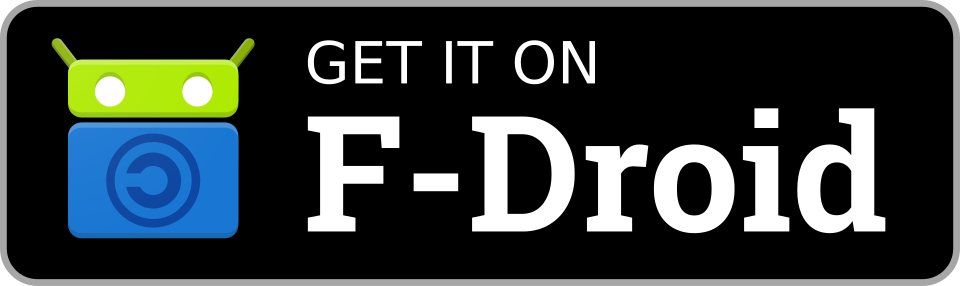
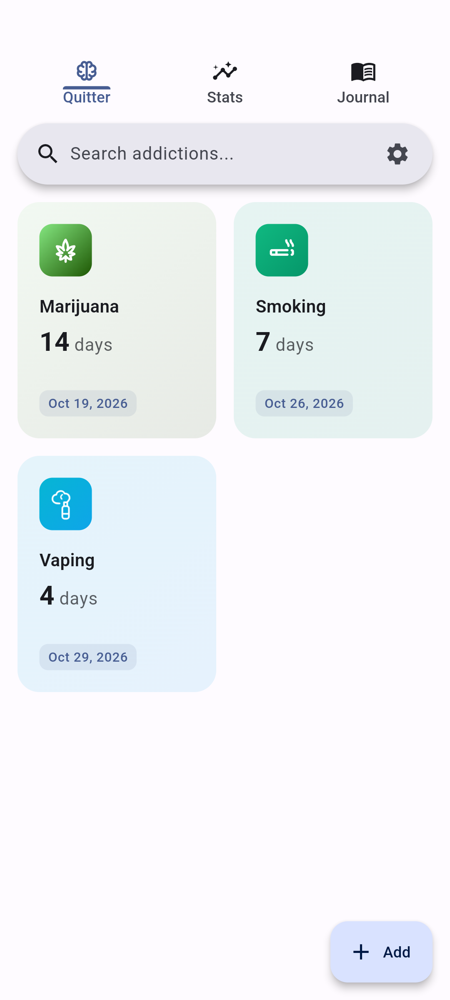
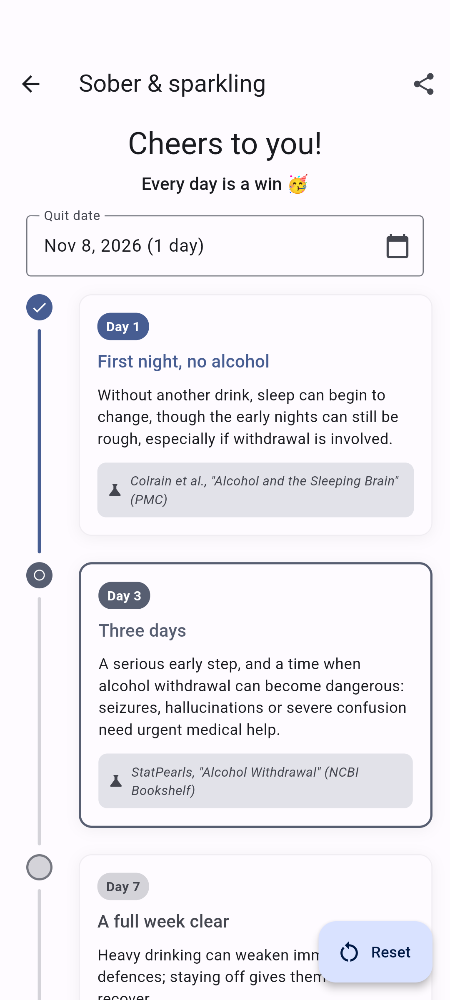
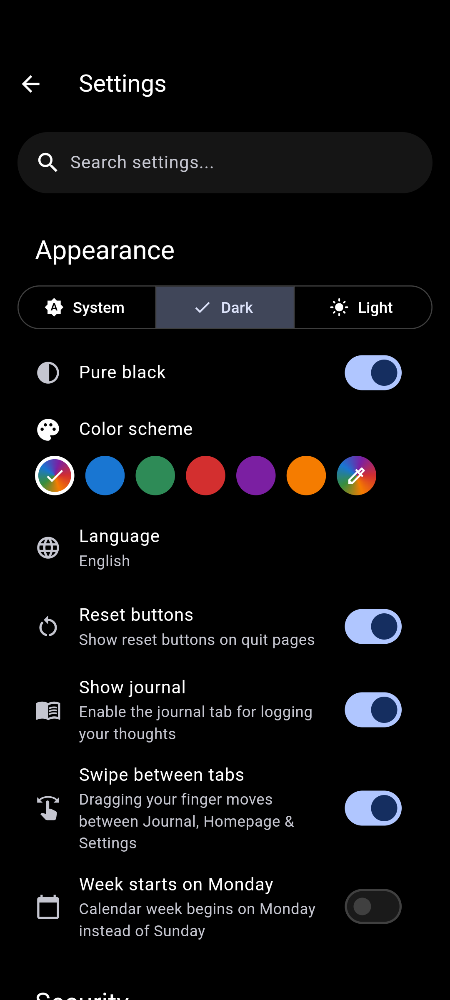
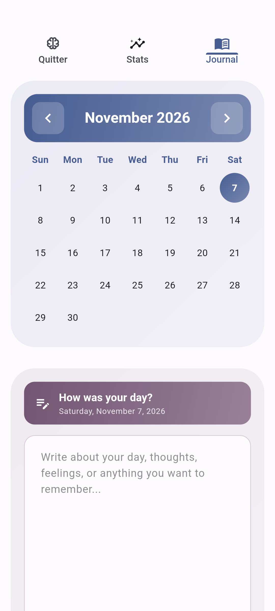
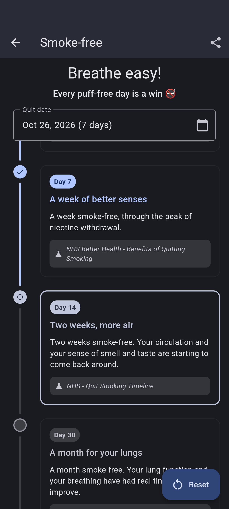
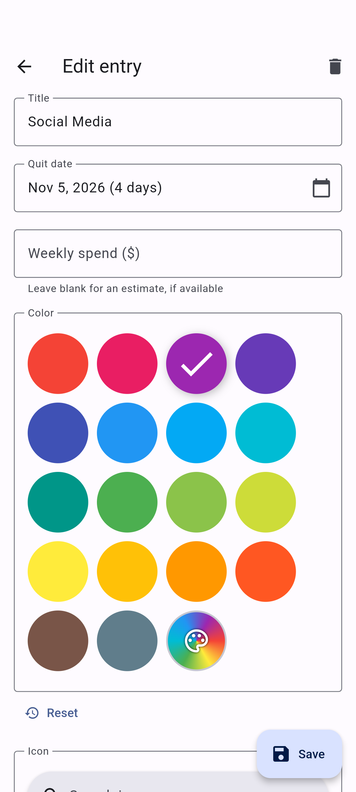
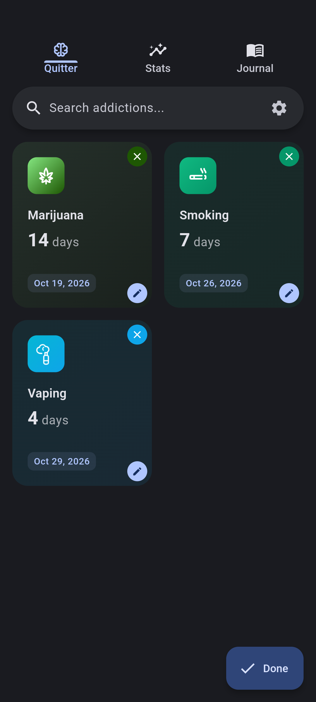
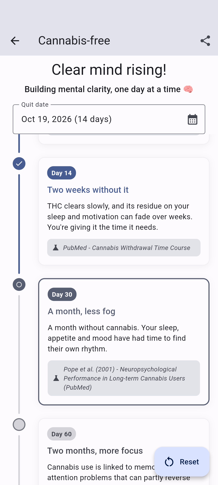

# Quitter

**Track your quitting journey without turning it into someone else's data.**

A free and open-source quit tracker built around local data, useful milestones, and a calm interface.

  
  
  

  
  
  

No tracking · Local data · Multiple journeys · Fully customisable

## See your progress, not a dashboard full of noise

  
  
    
  
  

More screenshots

 

  
  
    
  
  

## Help translate Quitter

Translations are maintained directly in `lib/l10n/`. Contributions for any supported language are welcome through normal pull requests.

## License

Quitter is available under the [MIT License](LICENSE.md).
